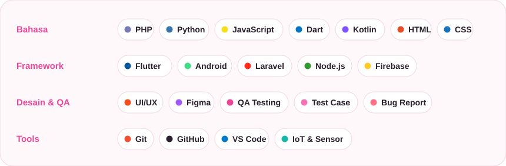

<!-- Repo ini harus bernama persis: breliandwioktaviani (sama dengan username), Public --> 
  

Tentang saya

Mahasiswa D3 Teknologi Informasi di Politeknik Negeri Madiun. Saya mengembangkan aplikasi mobile, website, dan sistem IoT, merancang tampilannya sebagai UI/UX Designer, lalu menguji hasilnya sebagai QA, supaya yang sampai ke pengguna benar-benar nyaman dipakai.

📱 Mobile: Flutter, Dart, Kotlin, Android
🌐 Web: Laravel, PHP, JavaScript, Node.js
🎨 Desain dan QA: UI/UX, Figma, pengujian aplikasi
🐟 IoT: sensor yang terhubung ke website dan aplikasi
Tech stack

  

Hubungi saya
<!-- Setelah portofoliomu online, hapus tanda komentar baris di bawah dan ganti link-nya: 
<a href="https://LINK-PORTOFOLIO-KAMU"><b>Lihat portofolio →</b></a>
 --> 
 <a href="mailto:brelianoktaviani@gmail.com"><b>Email</b></a> &nbsp;·&nbsp; <a href="https://wa.me/62895334804029"><b>WhatsApp</b></a> &nbsp;·&nbsp; <a href="https://www.linkedin.com/in/brelian-dwi-oktaviani-4a5346328/"><b>LinkedIn</b></a> &nbsp;·&nbsp; <a href="https://www.instagram.com/breliandwi"><b>Instagram</b></a> &nbsp;·&nbsp; <a href="https://medium.com/@breliandwiokt"><b>Medium</b></a> 
 
  

