<!-- Repo ini harus bernama persis: breliandwioktaviani (sama dengan username), Public -->

  <picture>
    <source media="(prefers-color-scheme: dark)" srcset="assets/profile-dark.svg" />
    
  </picture>

<!-- Setelah portofoliomu online, hapus tanda komentar baris di bawah dan ganti link-nya:

<a href="https://LINK-PORTOFOLIO-KAMU"><b>Lihat portofolio →</b></a>

-->

  <a href="mailto:brelianoktaviani@gmail.com"><b>Email</b></a> &nbsp;·&nbsp;
  <a href="https://wa.me/62895334804029"><b>WhatsApp</b></a> &nbsp;·&nbsp;
  <a href="https://www.linkedin.com/in/brelian-dwi-oktaviani-4a5346328/"><b>LinkedIn</b></a> &nbsp;·&nbsp;
  <a href="https://www.instagram.com/breliandwi"><b>Instagram</b></a> &nbsp;·&nbsp;
  <a href="https://medium.com/@breliandwiokt"><b>Medium</b></a>

